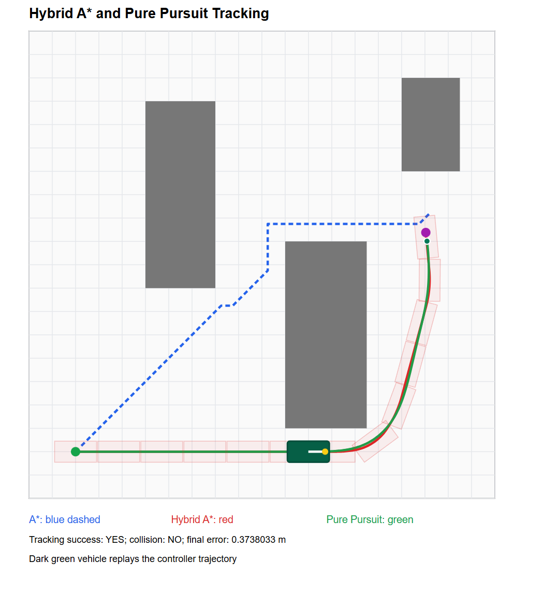

# 从 A* 到 Hybrid A*：阿克曼无人车路径规划实验

## 1. 研究背景

在移动机器人自主导航中，路径规划算法负责根据环境地图、车辆初始位置和目标位置，生成一条满足约束条件的可行路径。

传统 A* 算法能够在二维栅格地图中寻找路径，但通常将机器人简化为质点，只考虑位置变化，没有直接考虑车辆航向角及最小转弯半径等运动学约束。

对于采用阿克曼转向结构的轮式无人车，这种简化可能导致规划出的路径无法被车辆直接执行。

因此，本项目在实现基础 A* 算法后，进一步实现了 Hybrid A* 路径规划算法，并结合 Pure Pursuit 控制器开展轨迹跟踪仿真实验。

## 2. A* 路径规划算法

A* 是一种基于启发式搜索的路径规划算法，其评价函数为：

\[
f(n)=g(n)+h(n)
\]

其中：

- \(g(n)\)：从起点到当前节点的累计路径代价。
- \(h(n)\)：从当前节点到目标节点的启发式估计代价。
- \(f(n)\)：经过当前节点到达目标的估计总代价。

A* 通过优先扩展评价函数较小的节点，提高目标导向的搜索效率。

然而，传统二维栅格 A* 主要解决几何路径搜索问题，生成的路径不一定满足阿克曼车辆的转向约束。

## 3. 阿克曼车辆运动学模型

本项目采用运动学自行车模型描述阿克曼车辆运动：

\[
\dot{x}=v\cos\theta
\]

\[
\dot{y}=v\sin\theta
\]

\[
\dot{\theta}=\frac{v}{L}\tan\delta
\]

其中：

- \(x,y\)：车辆位置。
- \(\theta\)：车辆航向角。
- \(v\)：车辆行驶速度。
- \(L\)：车辆轴距。
- \(\delta\)：前轮转向角。

由于转向角受到机械结构限制，车辆存在最小转弯半径：

\[
R_{\min}=\frac{L}{\tan\delta_{\max}}
\]

因此，不能简单地将二维栅格搜索路径直接作为车辆可执行轨迹。

## 4. Hybrid A* 算法

Hybrid A* 在传统 A* 的基础上，将车辆航向角和运动学模型引入状态扩展过程。

在搜索过程中，不再简单地按照栅格的四邻域或八邻域扩展节点，而是根据一组离散控制输入，通过车辆运动学模型进行短时间前向仿真，生成具有运动学意义的候选轨迹。

本项目主要实现了：

1. 基于位置与航向角的状态表示。
2. 离散转向控制输入与运动基元生成。
3. 基于车辆运动学模型的状态扩展。
4. 基于矩形车体轮廓的碰撞检测。
5. 启发式搜索与路径重建。

该方法能够使规划结果更加符合阿克曼车辆的运动特性。

## 5. C++ 仿真实现

本项目使用 C++17 和 CMake 开发，主要模块包括：

| 模块 | 功能 |
|---|---|
| VehicleModel | 阿克曼车辆运动学模型 |
| GridMap | 地图表示及碰撞检测 |
| AStar | 基础 A* 搜索 |
| HybridAStar | 考虑车辆运动约束的路径规划 |
| PurePursuit | 车辆路径跟踪控制 |
| Visualization | 实验结果可视化 |

## Hybrid A* 核心 C++ 实现解析

本节结合项目源码，介绍 Hybrid A* 中的状态表示、运动基元、启发式搜索和碰撞检测。

完整源码：[Robot-Motion-Planning](https://github.com/zzy412/Robot-Motion-Planning)

### 1. 状态表示与离散化

Hybrid A* 的搜索状态不仅包含二维坐标，还包含车辆航向角：

$$
\mathbf{s}=(x,y,\theta)
$$

本项目在 `HybridAStar.h` 中定义了规划参数：

```cpp
struct HybridConfig {
    double xyResolution = 0.5;
    double headingResolution = PI / 12;
    double primitiveDuration = 0.8;
    double dt = 0.05;
    double speed = 1;
    double maxSteer = PI / 6;
    double goalPositionTolerance = 0.8;
    double goalHeadingTolerance = PI / 12;
    int maxExpanded = 130000;
    bool allowReverse = true;
};
```

其中：

- `xyResolution`：位置状态离散化分辨率。
- `headingResolution`：航向角离散化分辨率。
- `primitiveDuration`：每个运动基元的持续时间。
- `dt`：运动学积分时间步长。
- `maxSteer`：最大前轮转向角。
- `allowReverse`：是否允许倒车扩展。

搜索时，将连续位置和航向角映射到离散状态索引，用于记录不同状态的最小已知搜索代价。

### 2. 阿克曼车辆运动学

车辆使用运动学自行车模型：

$$
\begin{aligned}
\dot{x} &= v\cos\theta \\
\dot{y} &= v\sin\theta \\
\dot{\theta} &= \frac{v}{L}\tan\delta
\end{aligned}
$$

在 `VehicleModel.cpp` 中，通过 `step()` 更新车辆状态，并使用 `propagate()` 连续生成运动基元上的采样状态。

源码中对恒定速度、恒定转向角下的运动采用圆弧积分，而不是简单地逐步修改二维网格坐标。

### 3. 运动基元生成

在 `HybridAStar.cpp` 中，程序采用五种归一化转向输入：

```cpp
const double steering[5] = {
    -1, -0.5, 0, 0.5, 1
};
```

根据最大转向角，计算实际输入：

```cpp
double delta = angle * cfg.maxSteer;
```

车辆利用运动学模型向前或向后传播：

```cpp
auto segment = vehicle.propagate(
    n.state,
    dir * cfg.speed,
    delta,
    cfg.primitiveDuration,
    cfg.dt
);
```

因此，每次搜索扩展得到的不是简单的网格邻居，而是一段具有车辆运动学意义的短轨迹。

### 4. 车辆碰撞检测

在生成运动基元后，程序逐一检查轨迹采样点：

```cpp
bool free = true;

for (const auto& s : segment) {
    if (!map.poseFree(s)) {
        free = false;
        break;
    }
}

if (!free) continue;
```

`GridMap.cpp` 使用考虑航向角的矩形车体与轴对齐矩形障碍物进行碰撞检测。

这种方法比只检查车辆中心点更符合车辆外形，但由于采用离散采样，仍不能保证两个采样时刻之间绝对不会发生碰撞。

### 5. 路径搜索代价

程序的搜索代价主要考虑：

1. 行驶路径长度。
2. 倒车惩罚。
3. 较大转向角的惩罚。
4. 前进与倒车方向切换的惩罚。
5. 相邻运动基元转向角变化的惩罚。

这些代价共同引导搜索，使规划结果不仅关注路径长度，也考虑车辆运动过程中的控制特征。

需要说明：程序对转向变化施加的是搜索代价惩罚，并不等价于严格的转向速率约束。

### 6. 启发式函数

当前程序使用位置到目标点的欧氏距离，并加入航向误差项：

$$
h = \sqrt{(x-x_g)^2+(y-y_g)^2}
+0.35|\operatorname{wrap}(\theta_g-\theta)|
$$

航向误差项有助于引导搜索向目标姿态靠近。

不过，这种启发式函数不保证满足最优性所需的可采纳条件，因此当前实现不宣称能够找到全局最优路径。

### 7. 终点判断与路径重建

当车辆满足位置和航向容差时，搜索结束。

随后，程序通过保存的父节点索引回溯搜索树，再拼接各个运动基元中的采样状态，形成完整的规划路径。

当前实现使用容差终止，而不是精确的 Reeds–Shepp 解析连接。

### 8. 源码地址

- [HybridAStar.cpp](https://github.com/zzy412/Robot-Motion-Planning/blob/main/src/HybridAStar.cpp)
- [HybridAStar.h](https://github.com/zzy412/Robot-Motion-Planning/blob/main/include/HybridAStar.h)
- [VehicleModel.cpp](https://github.com/zzy412/Robot-Motion-Planning/blob/main/src/VehicleModel.cpp)
- [GridMap.cpp](https://github.com/zzy412/Robot-Motion-Planning/blob/main/src/GridMap.cpp)

通过以上实现，可以看到 Hybrid A* 如何将车辆运动学模型引入传统启发式搜索过程。

下一阶段将进一步研究更严格的转向速率约束、解析扩展与路径优化。

## 实验可视化



*图：A*、Hybrid A* 与 Pure Pursuit 轨迹跟踪实验结果。*

## 6. 实验结果与分析

在已有仿真场景中，两种算法均能够进行路径搜索，但规划结果具有不同特点。

A* 主要关注二维几何路径，搜索效率较高，但可能生成不符合车辆转向能力的路径。

Hybrid A* 由于在状态扩展过程中加入车辆航向角和转向控制，能够生成满足当前运动学模型约束的参考路径，但相应地需要更多搜索计算。

进一步加入 Pure Pursuit 后，可以根据参考路径计算车辆转向角，并通过车辆运动学模型得到实际跟踪轨迹。

实验说明，路径规划和轨迹跟踪是两个相互联系但不完全相同的问题。规划路径的可行性并不意味着车辆在有限转向响应下能够准确跟踪。

## 7. 阶段性总结

通过本次实验，我完成了从基础 A* 路径搜索到考虑车辆运动学约束的 Hybrid A* 路径规划的学习与实现，并初步建立了路径规划与轨迹跟踪一体化的 C++ 仿真流程。

下一阶段将进一步完善 ROS 2 平台下的实时闭环轨迹跟踪，并研究转向执行器约束下的速度规划与轨迹跟踪协同优化。

## 参考学习资源

- 《Motion Planning for Mobile Robots》Lecture 2：Search-based Path Finding
- 《Motion Planning for Mobile Robots》Lecture 4：Kinodynamic Path Finding
- [PythonRobotics](https://github.com/AtsushiSakai/PythonRobotics)
- [Hybrid A* Path Planner](https://github.com/karlkurzer/path_planner)