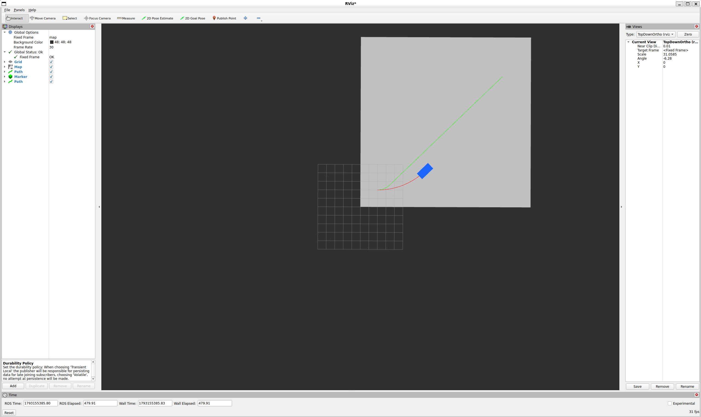

# ROS 2 Jazzy 实践：Hybrid A* 路径规划与阿克曼车辆仿真

## 1. 项目背景

在前面的 C++ 仿真实验中，我已经实现了基于阿克曼车辆运动学模型的 Hybrid A* 路径规划，以及 Pure Pursuit 轨迹跟踪等算法。

为了进一步向完整机器人导航系统过渡，本阶段开始使用 ROS 2，将路径规划与车辆运动学仿真封装为独立节点，并利用 RViz2 可视化地图、规划路径和车辆运动过程。

## 2. 开发环境

本项目使用的开发环境如下：

| 组件 | 环境 |
|---|---|
| 宿主机 | Windows |
| Linux 环境 | WSL2 Ubuntu 24.04 |
| 机器人中间件 | ROS 2 Jazzy |
| 编程语言 | C++ |
| 构建工具 | CMake、colcon |
| 可视化工具 | RViz2 |
| 车辆模型 | 阿克曼运动学自行车模型 |

当前阶段采用纯软件仿真，尚未接入真实传感器与无人车底盘。

## 3. ROS 2 工作空间与软件包

首先进入 Ubuntu 终端，加载 ROS 2 环境：

```bash
source /opt/ros/jazzy/setup.bash
```

创建工作空间：

```bash
mkdir -p ~/ackermann_ws/src
cd ~/ackermann_ws/src
```

创建功能包：

```bash
ros2 pkg create ackermann_navigation \
  --build-type ament_cmake \
  --dependencies rclcpp nav_msgs geometry_msgs
```

之后，将原有 C++ 工程中的车辆模型、栅格地图和 Hybrid A* 算法整理到 ROS 2 软件包中，并补充 ROS 消息发布、车辆仿真和 TF 广播等功能。

## 4. 系统结构

当前系统主要包括两个核心节点。

### 4.1 Hybrid A* 路径规划节点

规划节点 `planner_node` 负责：

1. 初始化二维地图。
2. 设置车辆起点和目标位姿。
3. 调用 Hybrid A* 路径规划算法。
4. 将地图发布为 `nav_msgs/msg/OccupancyGrid`。
5. 将规划结果发布为 `nav_msgs/msg/Path`。

主要输出话题：

- `/map`：二维占据栅格地图。
- `/planned_path`：Hybrid A* 生成的参考路径。

当前测试主要使用预设二维场景，并未接入实时 SLAM 地图。

### 4.2 阿克曼车辆仿真节点

车辆仿真节点 `vehicle_sim_node` 根据输入的速度和前轮转向角指令更新车辆状态。

其运动模型为：

\[
\dot{x}=v\cos\theta
\]

\[
\dot{y}=v\sin\theta
\]

\[
\dot{\theta}=\frac{v}{L}\tan\delta
\]

其中，\(v\) 为车辆速度，\(\delta\) 为前轮转向角，\(L\) 为轴距。

仿真节点订阅 `/drive` 话题，接收 `ackermann_msgs/msg/AckermannDriveStamped` 指令。

同时发布：

- `/odom`：车辆里程计信息。
- `/actual_path`：车辆实际运动轨迹。
- `/vehicle_marker`：RViz2 中的车辆模型。
- `map → base_link`：车辆坐标变换。

在当前实验中，车辆状态由运动学模型积分得到，并不代表真实传感器测量结果。

## 5. 编译 ROS 2 工程

进入工作空间：

```bash
cd ~/ackermann_ws
```

加载 ROS 2：

```bash
source /opt/ros/jazzy/setup.bash
```

编译功能包：

```bash
colcon build --packages-select ackermann_navigation
```

编译完成后，加载工作空间：

```bash
source ~/ackermann_ws/install/setup.bash
```

这里需要说明：前面创建的只是基础 ROS 2 软件包。要成功运行下面的节点，还需要完成本项目的 C++ 源码集成，以及 `CMakeLists.txt`、`package.xml` 中相关依赖的配置。

## 6. 运行路径规划与车辆仿真

建议使用多个 Ubuntu 终端分别运行程序。

### 终端一：路径规划节点

```bash
source /opt/ros/jazzy/setup.bash
source ~/ackermann_ws/install/setup.bash

ros2 run ackermann_navigation planner_node
```

该节点负责发布地图和 Hybrid A* 规划路径。

### 终端二：车辆仿真节点

```bash
source /opt/ros/jazzy/setup.bash
source ~/ackermann_ws/install/setup.bash

ros2 run ackermann_navigation vehicle_sim_node
```

车辆仿真节点负责更新车辆运动状态并发布里程计和可视化信息。

### 终端三：RViz2 可视化

```bash
source /opt/ros/jazzy/setup.bash
source ~/ackermann_ws/install/setup.bash

rviz2
```

打开 RViz2 后，将固定坐标系（Fixed Frame）设置为：

```text
map
```

添加以下显示项目：

| 显示类型 | Topic | 作用 |
|---|---|---|
| Map | `/map` | 显示二维地图 |
| Path | `/planned_path` | 显示规划轨迹 |
| Path | `/actual_path` | 显示车辆实际轨迹 |
| Marker | `/vehicle_marker` | 显示车辆模型 |
| Odometry | `/odom` | 查看车辆运动状态 |

对于只发布一次或需要读取历史消息的地图、路径等话题，应根据发布端 QoS 设置合适的订阅持久性。在本项目中，可以将相应 RViz2 显示项配置为 `Transient Local`。

## 7. 测试车辆运动

打开第四个终端，加载 ROS 2 环境后，发布简单的车辆控制指令：

```bash
ros2 topic pub --rate 10 --times 100 \
  /drive ackermann_msgs/msg/AckermannDriveStamped \
  "{drive: {speed: 0.5, steering_angle: 0.15}}"
```

这条命令每秒发布 10 次控制指令，共发送 100 次。

车辆仿真节点根据控制输入持续更新位姿，在 RViz2 中可以观察车辆及实际运动轨迹。

需要注意，当前测试使用的是预设速度和转向角，并未根据 Hybrid A* 规划路径实时生成控制指令。

因此，实际行驶轨迹可能与参考路径明显不同，这是当前开环控制测试的预期现象。

## 8. 实验结果

当前已经实现：

- ROS 2 中调用 Hybrid A* 规划算法。
- 发布二维地图与规划路径。
- 根据阿克曼运动学模型更新车辆位姿。
- 发布里程计、TF 和车辆可视化 Marker。
- 在 RViz2 中同时显示规划路径与实际运动轨迹。

在 RViz2 中，可以观察地图、规划轨迹和车辆运动状态之间的关系。



*图1：ROS 2 平台下 Hybrid A* 路径规划与阿克曼车辆运动学仿真结果*

## 9. 下一阶段计划

当前系统尚未完成规划路径到车辆控制指令的实时闭环连接。

下一阶段将增加 Pure Pursuit 控制节点：

1. 订阅 Hybrid A* 规划路径。
2. 订阅车辆里程计。
3. 计算目标前瞻点和前轮转向指令。
4. 向车辆仿真节点发布 `/drive` 指令。
5. 比较规划路径与实际轨迹之间的误差。

在此基础上，进一步研究车辆转向速率约束、曲率自适应速度规划及控制性能优化。

## 10. 总结

本阶段完成了从独立 C++ 运动规划程序向 ROS 2 模块化系统的初步迁移。

通过规划节点、车辆仿真节点和 RViz2 可视化工具，建立了后续开展在线轨迹跟踪和导航系统集成的基础。

后续研究将重点从规划结果的可视化验证，逐步转向考虑车辆运动约束的实时闭环轨迹跟踪实验。